# EML Plugin Manager for Praat

A plugin that installs, updates, and removes Praat plugins from
inside Praat. No native installer, no external runtime — Praat plus
what the operating system already ships.

Author: Ian Howell, Embodied Music Lab.

## Status

Version 0.7.3 (beta). Version 1.0.0 will be the first public
release. Install from disk, remove, the installed-command report,
the manager's own install file, and Create install file for a
plugin all work and are verified against the test harness in
`harness/`, including installs and removals of real published
plugins in every supported archive shape.

What the repository contains:

- `plugin_EMLPraatPluginManager/install-from-disk.praat` — installs an
  already-downloaded plugin (`.zip`, `.tar.gz`/`.tgz`, or an
  unpacked folder). Finds every `plugin_` folder at any depth
  inside the source and presents a checklist. Offers a canonical
  rename when a folder name carries a suffix such as `-main` (your
  choice — it never forces one). When a same-named plugin is
  already installed, compares versions and labels each choice
  (newer, equal, older) before you decide. Archives any plugin it
  replaces and never deletes anything except its own staging
  folder.
- `plugin_EMLPraatPluginManager/remove-plugin.praat` — removes an
  installed plugin. Selection checklist, then a confirmation dialog
  that states exactly what will be archived and deleted and
  requires an explicit switch before anything happens. The plugin
  is copied to the archive folder and the copy's file inventory
  verified before any original is deleted; nothing is ever deleted
  without an archived copy.
- `plugin_EMLPraatPluginManager/create-install-file.praat` — generates
  a standalone `install-<name>.praat` inside a plugin's own folder
  (an installed plugin, or any folder you choose), so the plugin's
  author can zip the folder as usual and a user can install it by
  opening and running that one file, with no copy of this manager
  on their machine. Regenerate it
  after adding or removing files in the plugin's folder, or after
  changing `setup.praat`'s registered commands.
- `plugin_EMLPraatPluginManager/setup.praat` — registers the menu
  commands.
- `eml-plugin-manager-install.praat` (repo root) — the install
  file: one self-contained script that installs the manager. Open
  it in Praat, run it, restart Praat. It is regenerated from the
  plugin folder and is the file to distribute, from anywhere.
- `docs/` — the product design roadmap and FAQ.
- `harness/` — the verification driver, fixtures, drive record,
  and screenshot evidence.
- `planning/` — the pinned generation specifications and review
  handbacks that produced the code.
- `tools/build_installer.py` — regenerates the install file from
  the plugin folder; `--check` verifies the two agree. After any
  edit to the plugin folder, run the tool and commit the
  regenerated install file with the edit.
- `hooks/pre-commit` — refuses a commit when the install file has
  drifted from the plugin folder. Enable once per clone with
  `git config core.hooksPath hooks`. CI runs the same check on
  every push.

## See it work

These recordings show Praat 7.0.03 on Linux. Each one is a real run
of this version.

### Get started

Install the manager, restart Praat, and then install two plugins
from one downloaded zip.

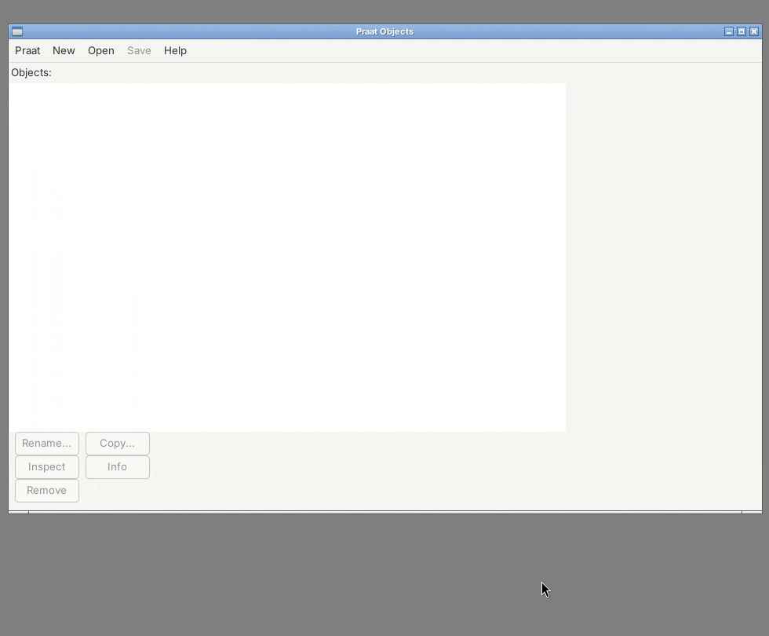

When Praat's Trust window asks, choose the third button, "Yes, and I
even allow this script to CONTROL MY COMPUTER from now on".

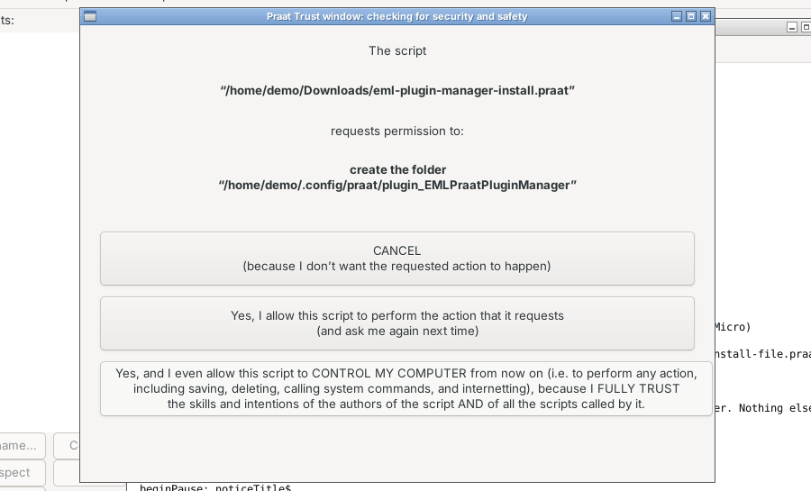

After a restart, the manager's three commands are in the Praat menu.

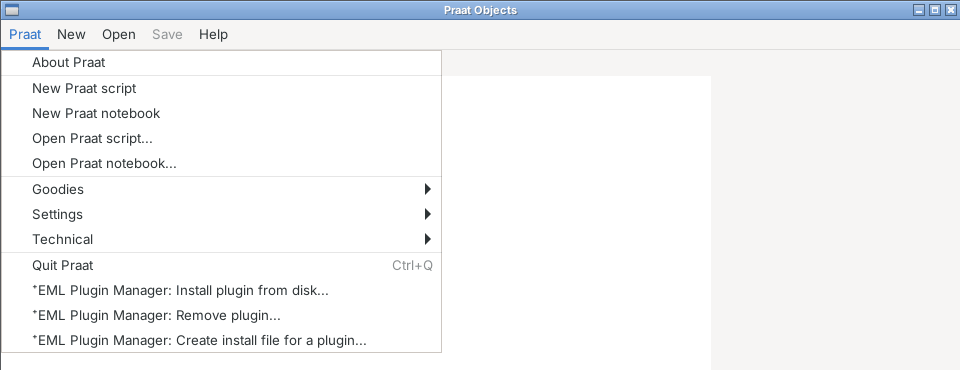

### Install a plugin you already downloaded

Pick a `.zip`, `.tar.gz`, or folder. The manager finds every plugin
inside it, offers to clean up folder names such as `-master`, and
reports where each new command appears.

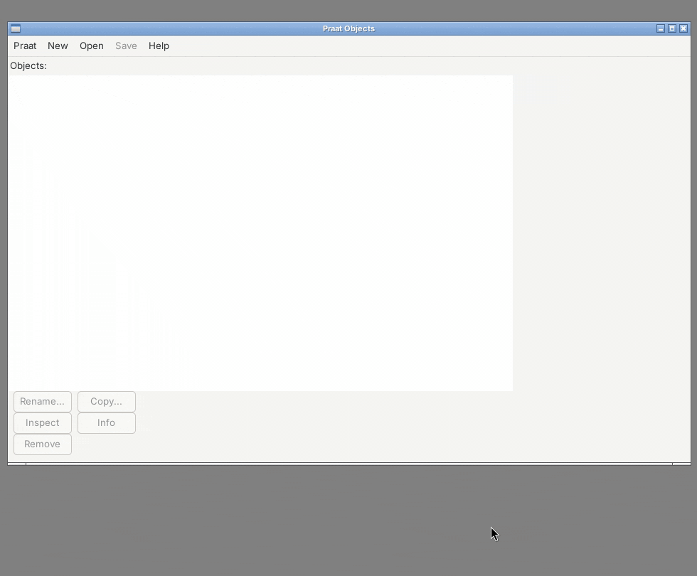

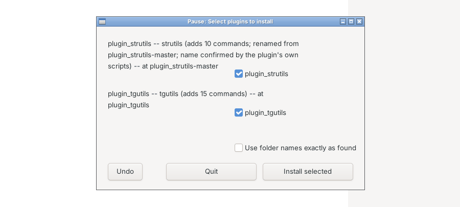

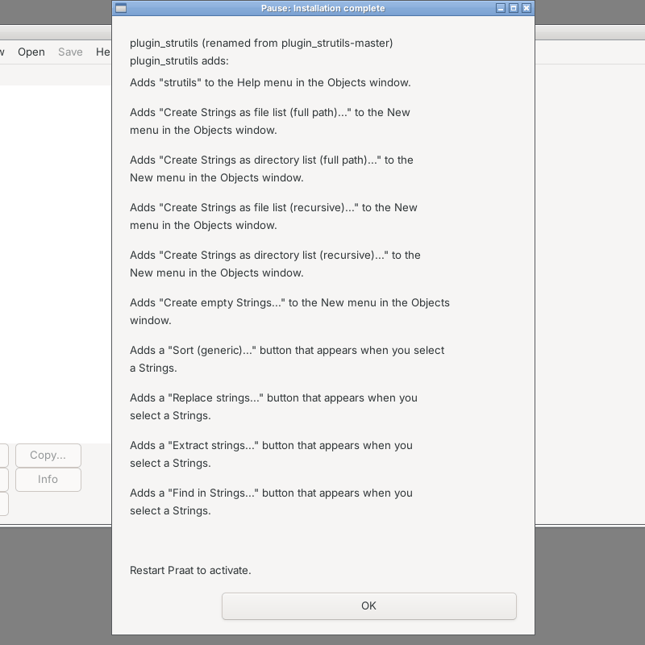

### Remove a plugin

The manager archives a plugin, checks the archived copy, and then
deletes the original. Nothing is deleted until you switch on the
safety switch.

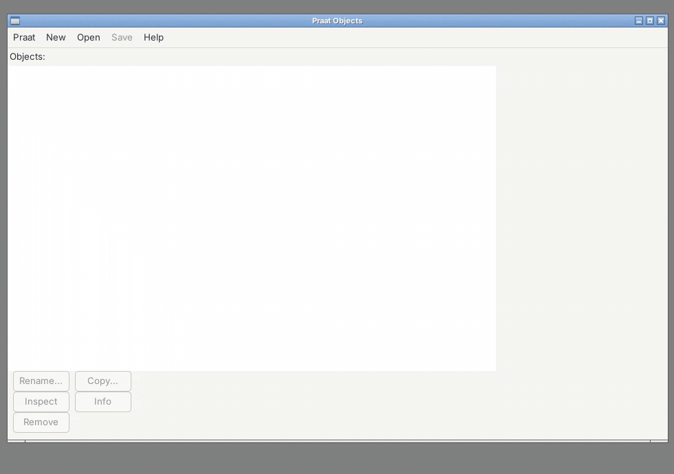

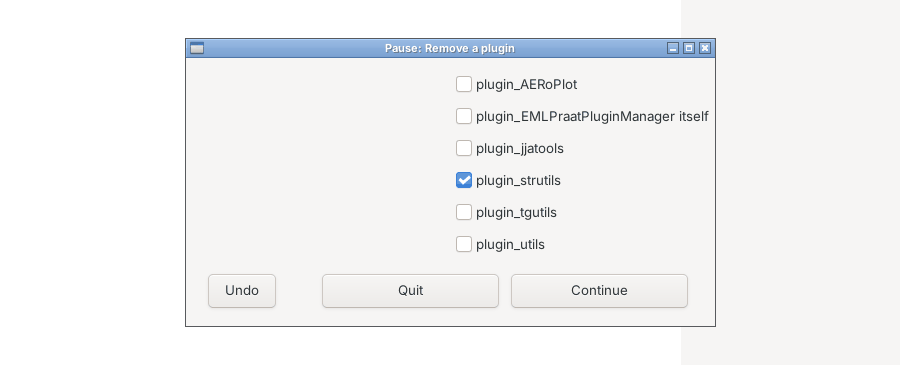

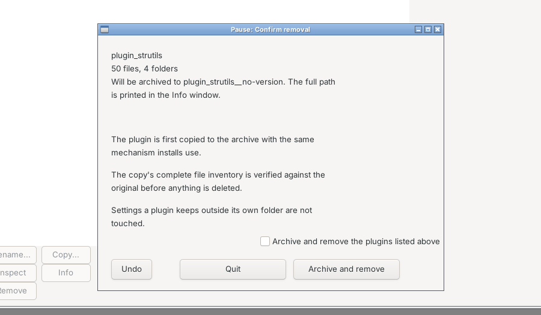

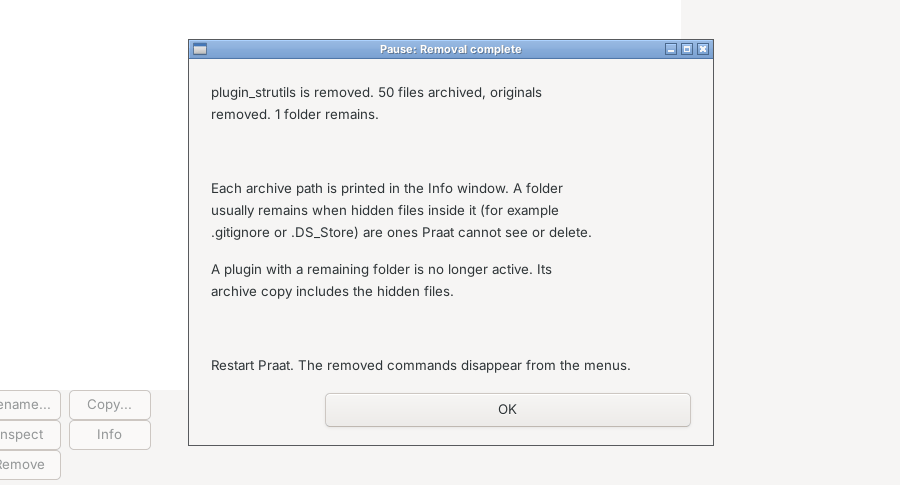

### Create an install file for any plugin

Write an `install-<name>.praat` file into a plugin's folder. Zip the
folder as usual; anyone can install the plugin by running that one
file, with no copy of the manager.

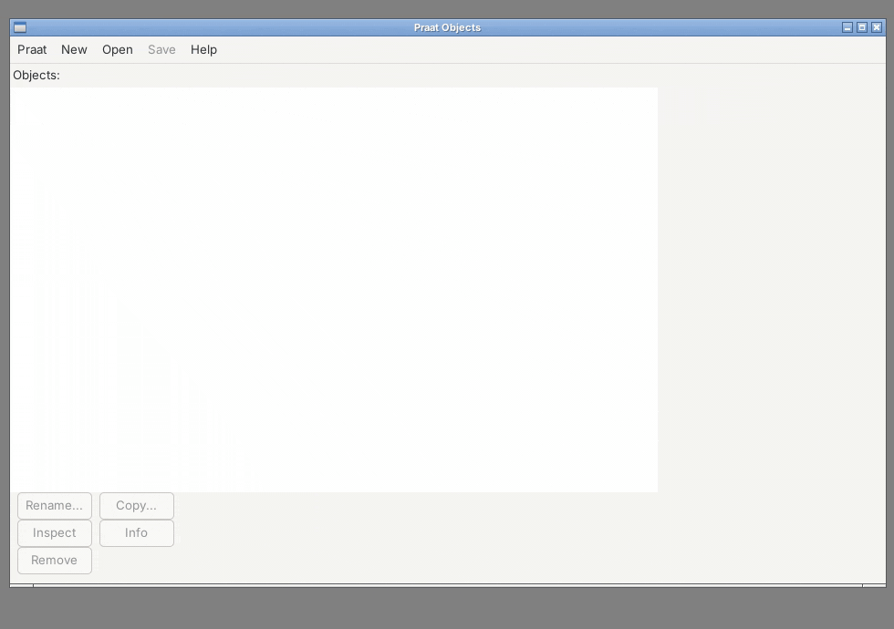

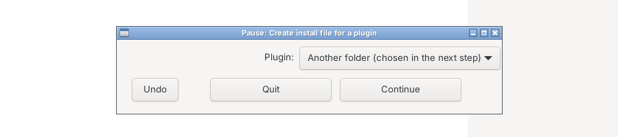

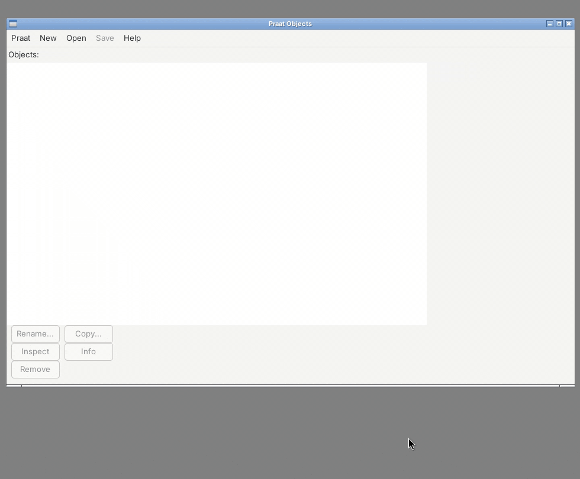

## Install

Two routes:

1. **Install file (recommended).** Download
   `eml-plugin-manager-install.praat`, open it in Praat
   (**Praat > Open Praat script...**), and run it. Restart Praat.
2. **Manual.** Copy `plugin_EMLPraatPluginManager/` into your Praat
   preferences folder and restart Praat. The preferences folder is
   named in Praat's manual under "preferences folder".

After installing, the manager's commands appear in the Praat menu.

## Requirements

Praat 6.6.30 or newer, including Praat 7.

The manager's multi-page dialogs size their pages for a screen that is
at least 900 pixels tall.

If Praat asks whether to trust a script, choose the third button,
"Yes, and I even allow this script to CONTROL MY COMPUTER from now
on". The manager writes and deletes many files, and Praat would
otherwise ask again for each one. Praat asks once for each manager
command, and again the next time you start Praat. Every prompt
arrives in direct response to an action you took; nothing runs at
startup. Praat 6.6 has no Trust window and shows no prompt.

## License

GNU General Public License v3.0. See the `LICENSE` file.
